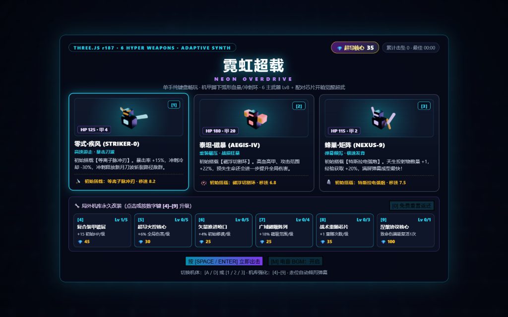
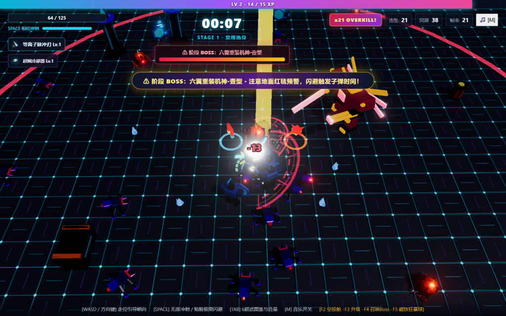

# 霓虹超载：机甲幸存者 | NEON OVERDRIVE 3D

<p align="center">
  <a href="https://dyc19991225.github.io/neon-overdrive-3d/">
    
  </a>
  
  
  
</p>

> **单手纯键盘畅玩的 3D 赛博机甲割草爽游（Vampire Survivors-like）** —— 驾驶实验型战斗机甲孤军深入霓虹废墟，在同屏千台失控机械卫队的包围网中高速走位、自动倾泻弹幕，凑齐 **「Lv8 主武器 + Lv1 核心芯片」** 开箱觉醒 **6 大毁天灭地超武（Hyper Weapons）**，贴脸冲刺触发 **极限闪避子弹时间**，迎战六翼重装机神 Boss！

### 👉 在线即玩地址：**[https://dyc19991225.github.io/neon-overdrive-3d/](https://dyc19991225.github.io/neon-overdrive-3d/)**
*(电脑/手机浏览器点开即玩，零下载、零外置音频包，原生支持 **手机竖屏/横屏动态虚拟摇杆 + 触屏冲刺闪避** 与 **电脑单手纯键盘** 双端操作)*

---

## 📸 实机画面预览

| 机甲选择与局外机库永久改装 | 六翼泰坦 Boss 红毯预警 · 地面弧形血槽 · 空投道具 |
| :---: | :---: |
|  |  |

---

## ✨ 核心特色亮点

- **🗺️ 三大 3D 灾害战区场景 + 📅 每日 UTC 固定种子特遣挑战**
  - **霓虹废墟 · 第零区 (`1.0x 💎`)**：标准赛博废墟全息塔与高爆等离子桶链，定期空投战术骇入信标。
  - **熔芯铸造厂 · 炼狱炉 (`1.35x 💎`)**：工业熔炉反应釜地貌，周期喷发 **地热熔岩火柱**（敌我不分，可诱敌入火海融化或贴边蹭出极限闪避！）。
  - **极寒量子中枢 · 零度核 (`1.75x 💎`)**：量子水晶方尖碑地貌，高难敌群强化，量子塔周期释放 **极寒超导冰环** 冻结敌群 `55%` 移速并放大伤害。
  - **每日特遣挑战**：基于 UTC 日期确定性哈希固定当日战区、推荐机体与全局词缀（首次完成额外奖励 `+💎90` 超导核心）。
- **📡 地图战术占点骇入 + 💥 机甲专属超载终极大招 + 👾 远程电浆狙击敌机**
  - **占点守圈博弈**：战场周期降落 **📡 超导骇入信标**（守圈充能空投进化舱）与 **🩸 狂猎挑战祭坛**（守圈召唤双金甲统领赢取 `+💎30` 核心与狂暴球）。
  - **专属超载必杀 (`[Q]` / 手机 `💥` 键)**：杀敌与极限闪避积攒能量，释放 **次元千本樱**（16 道环形刀波）、**地核崩裂炮**（全屏核爆+回血 35%）或 **天穹浮游齐射**（12 道审判雷柱+全图磁吸）！
  - **远程电浆狙击浮游炮 (`Enemy_SniperDrone`)**：保持中距环绕走位并发射高速红晶电浆弹，既考验横向拉扯也可主动撞弹冲刺触发子弹时间。
- **🤖 3 台高精度硬表面骨骼动画机甲 + 头冠 V 字天线与可动武装机构**
  - **零式·疾风 (`STRIKER-0`)**：高达金色 V 字头冠、四翼可动气动推进背包与腰佩太刀鞘，冲刺/超载时四翼动态展翼，暴击率 `+15%`、冲刺冷却 `-30%`。
  - **泰坦·磁暴 (`AEGIS-IV`)**：重甲战术角饰头盔、双肩反应盾甲与独立液压后坐双联 6 管微型导弹巢，高血高甲、范围 `+22%`，损血叠加狂暴增伤。
  - **蜂巢·矩阵 (`NEXUS-9`)**：精神感应水晶头冠、背部旋转量子光环与 **6 枚独立 3D 环绕律动浮游炮（Fin-Funnels）**，天生全武器投射物 `+1`、经验获取 `+20%`。
- **⚡ 6 把自动武器 × 6 组 `1:1` 超武质变合成（12 分钟极速局）**
  - 主武器升至 **Lv 8** + 持有对应 **Lv 1 被动芯片**，拾取精英或 Boss 掉落的金色超导空投舱即可 100% 进化超武！
- **🔥 刀刀到肉的 3D 打击感（Game Feel）与极限闪避（Witch-Time）**
  - **贴脸/红毯极限闪避**：在敌机贴身或 Boss 地面红毯预警区内按下 `Space` 冲刺，瞬间触发 **`0.28x` 桑德斯坦子弹时间** + 低通滤波混音压制 + 立即返还 `35%` 冲刺冷却！
  - **物理级反馈**：纯三轴旋转 `Trauma²` 震屏、FOV 变焦冲击弹簧、双时钟卡肉微顿帧（Sakurai Hitstop）、体积守恒受击挤压回弹、白→品红二段受击强闪与抛物线暴击跳字（支持 `[V]` 键三档调节或关闭震屏强闪）。
- **👁️ 中心视野战斗可读性 + 多巴胺空投道具**
  - 机甲脚下内置世界坐标对齐的 **左绿弧形血量环** 与 **右青弧形冲刺充能环**，搭配视野外 **📦 空投舱 / ⚠ Boss / 🧲 道具边缘追踪箭头**。
  - 击碎地图高爆等离子桶或重装精英可掉落 **🧲 全屏超导磁铁**（一键吸空全图晶体）与 **🔥 无限超载狂暴球**（`5.5s` 射速翻倍 + 金色狂暴光环）。
- **☠️ 六翼重装机神 Boss 三阶段地面红毯博弈**
  - 第 `4:00 / 8:00 / 12:00` 降临阶段泰坦 Boss，拥有 **直线暴冲红毯锁定**、**四向旋转切割激光网** 与 **天基连环轰炸红圈** 三大地面预警技能。
- **🔧 局外机库永久改装 + 结算武器 DPS 伤害占比榜**
  - 单局结算详细展示每把武器/超武的总输出、伤害占比 `%` 与实时 `DPS`，并发放 **💎 超导核心**；采用带版本号与 `.bak` 自动备份链的本地持久化存档，自由升级装甲、火控、移速、磁吸、重随与 **涅槃满能复活协议**（支持一键无损重置返还）。
- **🎵 立体声卷积混响 + 空间声像定位 + 三战区专属 130 BPM 赛博电音 BGM**
  - 纯 WebAudio 程序化双声道脉冲响应混响（Convolver Reverb）、乒乓立体声延迟（Ping-Pong Delay）、基于世界坐标的左右声像定位（`StereoPanner`）与 `±6%` 微音高人性化防疲劳采样；三大战区各具专属 4 小节和弦进行与和声调式，支持菜单/子弹时间自动闪避压低（Ducking）。
  - 全敌群高精度倒角硬表面建模 + `InstancedMesh` 合批渲染 + `gridHead`/`gridNext` 全空间哈希邻域碰撞查询，同屏 **1,200 台** 3D 机械敌群依然流畅丝滑。

---

## ⚔️ 全 6 组超武 1:1 合成配方表

| 主武器 (Lv 1 → Lv 8) | 配对核心芯片 (Lv 1+) | 觉醒超武 (`★ Hyper`) | 超武形态质变效果 |
| :--- | :--- | :--- | :--- |
| **等离子脉冲刃** | **超频冷却器** (`-9%` 冷却/级) | **★ 幻影暴雨** | 取消装填间隔，化作青金双螺旋光刃洪流倾泻，命中分裂次级折射飞刃 |
| **磁浮切割环** | **引力增幅器** (`+14%` 范围/级) | **★ 绝对领域·日冕** | 内外双层共 8 枚巨型日冕锯轮反向永动，形成无法近身的绞肉力场 |
| **特斯拉电弧炮** | **多核分裂器** (`+1` 数量/级) | **★ 雷神矩阵** | 齐射苍白雷柱，弹跳上限飙升至 16 次，电毙目标原地引爆感电磁暴圈 |
| **高能激光横扫** | **高压电容** (`+14%` 伤害/级) | **★ 歼星棱镜** | 展开 360° 四向旋转虹光歼星十字斩，扫过之处爆发持续电浆震荡 |
| **纳米引力阱** | **纳米虹吸器** (`+30%` 磁吸/级) | **★ 黑洞奇点** | 生成吞噬全场的超级黑洞视界，强力拖拽聚怪并引爆毁灭级奇点坍缩 |
| **轨道离子迫击** | **狂暴推进器** (`+15%` 弹速持续/级) | **★ 天基审判** | 天基矩阵全功率齐射，连续降下多道贯穿天地的金色审判光柱与冲击波 |

*(另有生存芯片 **泰坦反应装甲**：每级 `+25 最大生命 & +6 护甲`)*

---

## ⌨️ 操作指南

| 场景 | 按键 / 操作 | 功能说明 |
| :--- | :--- | :--- |
| **手机触屏** | **左侧动态浮动摇杆** + **右下 `⚡ 冲刺` 键** | 任意处按住滑动实现 `360°` 模拟量走位引导，右下独立多指冲刺键（支持圆环冷却显示、贴脸极限闪避震动反馈与顶部 `📖 图鉴` 一键暂停） |
| **战斗走位 (PC)** | `W A S D` / `方向键` | 移动机甲并平滑引导机身朝向（控制激光横扫与冲刺方向） |
| **核心动作** | `Space` / `Left Shift` | **无敌相位冲刺** + 强化吸豆（带 `180ms` 输入缓冲；危险区贴脸按触发 **★ 极限闪避子弹时间**） |
| **升级三选一** | `[1] [2] [3]` / `[A][D]` + `Space` / 鼠标点击 | 秒选强化模块；按 **`[R]`** 消耗次数重随卡池 |
| **图鉴与混音** | `Tab` / `P` / `Esc` | 暂停并打开 **6 超武合成图鉴**、BGM/音效独立滑块 |
| **快捷开关** | `[M]` / `[V]` | `[M]` 一键静音/开启电音 BGM；`[V]` 循环切换震屏与受击强闪（`100% / 50% / 关闭`） |
| **标题机库** | `[1][2][3]` 选机甲 · `[4]`–`[9]` 改装 · `[0]` 重置 | 纯键盘或鼠标点击完成机体切换、机库永久升级与免费洗点，`Space / Enter` 出击 |
| **爽玩调试键** | `F2` / `F3` / `F4` / `F5` | `F2` 空投进化舱 · `F3` 秒升一级 · `F4` 召唤六翼泰坦 Boss · `F5` 投放全屏磁铁+狂暴球 |

---

## 🛠️ 本地运行与二次开发

环境要求：**Node.js >= 20**

```bash
# 1. 克隆仓库
git clone https://github.com/dyc19991225/neon-overdrive-3d.git
cd neon-overdrive-3d

# 2. 安装依赖
npm install

# 3. 启动本地开发服务器 (默认 http://127.0.0.1:5188/)
npm run dev

# 4. TypeScript 类型检查与生产环境分包构建 (输出至 dist/)
npm run build
npm run preview
```

### 目录结构

```text
neon-overdrive-3d/
├── index.html                  # HUD、标题机库面板、升级三选一、6超武图鉴与结算 DPS 面板结构
├── vite.config.ts              # 相对路径 base: './' 与 three-core / three-addons 分包配置
├── src/
│   ├── main.ts                 # 核心双时钟循环、空间哈希千怪碰撞、6超武、Boss三红毯AI与3D地面弧形环
│   ├── config.ts               # 3 台机甲、6 主武器、7 被动芯片与升级经验曲线数值表
│   ├── meta.ts                 # 版本化 localStorage 机库存档 (.bak 备份链) 与单局武器 DPS 追踪器
│   ├── audio.ts                # 双总线 WebAudio 合成器 + 130 BPM 自适应赛博电音 BGM 与自动闪避混音
│   ├── vfx.ts                  # InstancedMesh 碎片/星芒闪光/冲击波/刀波/闪电链/天基光柱与抛物线跳字池
│   └── style.css               # 赛博霓虹玻璃拟态 UI 与响应式布局
├── public/
│   ├── models/                 # 机甲、武装背包、4类敌机、六翼泰坦Boss、废墟掩体、武器与空投道具 GLB
│   ├── ui/                     # 24 张 Blender Cycles 光追渲染 192x192 RGBA 硬件立绘图标
│   ├── textures/               # 512x512 无缝赛博六边形地面 Albedo / Normal / Emissive PBR 贴图
│   └── vfx/                    # 冲击波、星芒、流动激光束与新月刀波 RGBA 粒子贴图
├── scripts/                    # Blender 5.3 无头建模/光追图标渲染与 Pillow 贴图生成 Python 脚本
└── docs/                       # GDD 游戏设计总纲、子系统数值文档与资产合规清单 (asset-manifest.json)
```

---

## 📄 开源协议与致谢 (License & Credits)

本项目源码与程序化生成资产基于 **[Apache-2.0 License](LICENSE)** 开源（完整资产溯源见 [docs/asset-manifest.json](docs/asset-manifest.json)）：
- 玩家基础骨骼动画底盘 `public/models/RobotExpressive.glb` 源自 Three.js 官方示例（作者 Tomás Laulhé / Don McCurdy，**CC0-1.0** 公共领域授权）。
- 其余硬表面机甲背包、敌群、六翼泰坦 Boss、废墟场景、武器掉落模型及 Cycles 光追 UI 图标均由仓库内 `scripts/*.py` 脚本生成。
